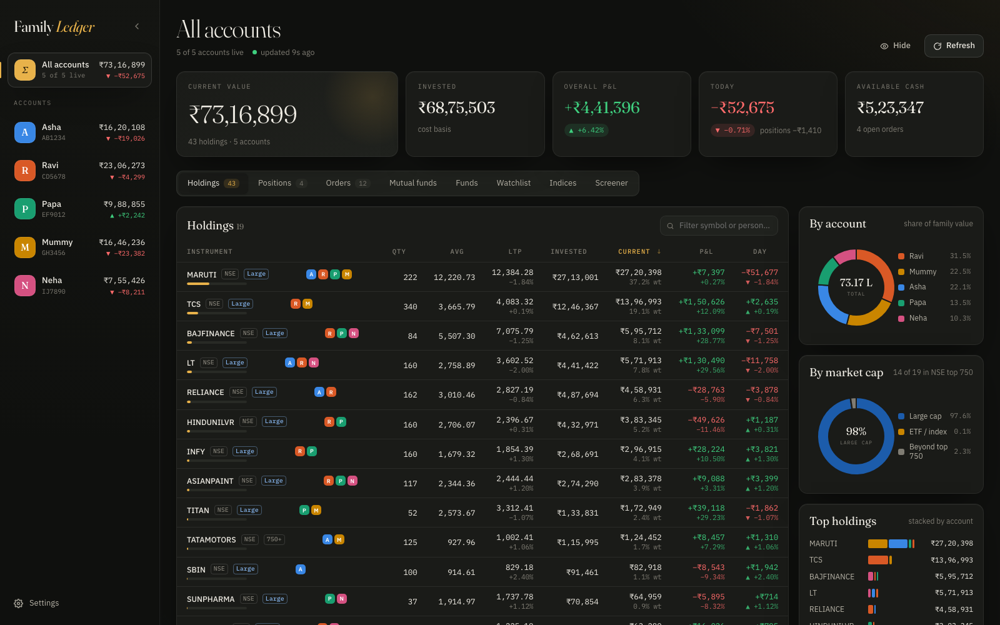

# Family Ledger

One dashboard for every Zerodha Kite account in your family.

Family Ledger runs **on your own computer** and shows holdings, P&L, today's
change, positions, orders, mutual funds and available funds for each account
and for the whole family combined, from a single page. It also has a shared
watchlist, live index cards, market-cap allocation, a stock screener and
TradingView charts. No more logging in and out of five Kite tabs.

- **Private by design.** Nothing is uploaded anywhere. Credentials and session
  tokens stay in a local folder on your machine, and the server only listens on
  `127.0.0.1`.
- **Read-only.** The app never places, modifies or cancels orders.
- **Free.** Uses Zerodha's free Kite Connect *Personal* API, Yahoo Finance and
  free TradingView widgets.



## Requirements

- macOS (tested on macOS 15/26). Linux should work for everything except the
  per-account browser-profile launcher; Windows is untested.
- Python 3.11 or newer.
- A Zerodha account for each family member you want to track.

## Install

```bash
git clone https://github.com/ansarigulshad/fin-ledger-dashboard.git
cd fin-ledger-dashboard
./setup.sh          # creates .venv and installs dependencies
./run.sh            # starts the dashboard at http://127.0.0.1:8765
```

`./stop.sh` stops it. To see the dashboard with fake data before adding any
account, run `DEMO=1 ./run.sh`.

## Add your accounts

Click **Add account** in the left rail. For each person enter a display name,
their Kite user ID and a colour, then pick how that account logs in.

### Option A: Kite Connect (recommended, free, no password stored)

Each family member creates a free *Personal* app once. It takes a minute:

1. Sign in at <https://developers.kite.trade> with that person's Zerodha login.
2. *Create new app* → type **Personal** → their Zerodha client ID → redirect URL
   **`http://127.0.0.1:8765/api/kc/callback`** (the account form shows it too).
3. Paste the app's **API key** and **API secret** into the account form.

Login is then a popup where the person signs in on Zerodha's own page. Password,
TOTP and any CAPTCHA happen there; the dashboard only receives the daily access
token. One Kite Connect app works for exactly one Zerodha user, so it is one
app per person.

**Tip: give each person their own browser profile.** Kite's login page
remembers the last user ID it saw in a browser. If you create a browser profile
per family member (Chrome or Brave: avatar menu → *Add*), pick it under *Open
Kite login in* on the account form. The dashboard then launches that profile
for the login and the right user is always pre-selected. (macOS only.)

### Option B: paste an enctoken (no setup)

Log in to kite.zerodha.com in any browser, open DevTools → Application →
Cookies → kite.zerodha.com, and paste the `enctoken` value into the login
dialog. Works until that Kite session ends.

### Option C: password + TOTP (fallback)

Saved under *Fallback* on the account form. Zerodha usually answers scripted
password logins with a CAPTCHA error, so treat this as best-effort.

## Daily use

- Zerodha invalidates every session early each morning (SEBI requires a fresh
  two-factor login per trading day), so each account needs one login per day.
  Press **L** (or *Login all*) and the dashboard walks through every account
  that needs it, one popup each. Sessions then persist across app restarts for
  the rest of the day.
- **0** = All accounts, **1–9** = jump to an account, **R** = refresh, **/** =
  filter holdings, **[** = collapse the sidebar, **H** = hide amounts, **Esc** =
  close dialogs.
- **Hide** (or **H**) blurs every rupee amount and quantity on the page for use
  in public places; percentages stay visible. The setting persists until you
  switch it back.
- Auto-refresh polls every 45 s while the tab is visible (toggle in the rail).
- The current view is in the URL hash (`#a=<id>&s=orders`), so views can be
  bookmarked.

## What's inside

| Tab | What it shows |
|---|---|
| **Holdings** | Sortable table with P&L, day change and weight. In *All accounts* each row shows who holds it; click to expand per person. Side charts: value by account, allocation by stock, **by market cap** (large / mid / small / micro per SEBI, from NSE index lists), top holdings stacked by account, today's movers. Click a donut segment to filter the table. |
| **Positions / Orders / Mutual funds / Funds** | Per account, or combined with an account column. |
| **Watchlist** | One list shared by the family, stored locally. Add by symbol or company name (NSE instrument list), see who already holds each stock, add notes. Prices from Kite for held stocks, Yahoo Finance otherwise. |
| **Indices** | NIFTY 50, SENSEX, NEXT 50, 100, 500, midcap, smallcap, India VIX and the sectoral indices, with day change, intraday sparkline and range. No login needed. |
| **Screener** | TradingView's free screener for Indian stocks, plus links to NSE MarketLens, Screener.in, Chartink, Trendlyne and Tickertape. |
| **Charts** | The chart icon on any holding, watchlist row or index opens a full TradingView chart overlay with links to TradingView, Kite's own chart and Screener.in. |

## History: ledger and tradebook imports

Kite Connect has no API for past statements, so history is an **import**.
Download from console.zerodha.com as CSV:

- **Ledger:** Funds → Statement → Ledger.
- **Tradebook:** Reports → Tradebook.

Open the **History** tab, click **Import statement**, pick the account and drop
the files. A preview shows the date span, the financial years covered and how
many stored rows will be replaced before anything is written.

- **First import:** the full history.
- **After that:** just the current financial year (1 April → today), as often
  as you like. Rows inside the uploaded file's date range are replaced, so
  re-imports are safe and pick up Zerodha's own corrections.
- **Ended financial years are archived** after their first import and later
  uploads never change them, unless you tick "also replace archived years".

What you get: money deposited and withdrawn over the years, net capital in,
gain on that capital and **XIRR** using today's live account value, F&O P&L
by segment and month, charges by type and year, and from the tradebook FIFO
realised P&L per stock, win rate, holding periods and activity by month.
Imported data is stored under `data/history/`.

Ledger files contain your bank account number. They stay on your machine, but
strip that before sharing a ledger with anyone else.

## Where your data lives

Everything is in the `data/` folder next to the code, which is git-ignored:

| File | Contents |
|---|---|
| `data/accounts.json` | Account names, user IDs, API keys/secrets, optional fallback password/TOTP secret. Written with mode 600. |
| `data/sessions.json` | The day's access tokens. |
| `data/watchlist.json` | Your watchlist. |
| other files | Cached NSE instrument and index lists (public data). |

**Never commit the `data/` folder.** If you fork or share this repo, check
`git status` before pushing. The included `.gitignore` already excludes it.

The server binds to `127.0.0.1` only. Don't change that to `0.0.0.0` or put it
behind a public URL: the dashboard has no login screen of its own, so anyone who
could reach it would see your family's holdings. If you want access from your
phone, use a private network such as Tailscale, never port forwarding.

## Good to know

- Kite allows one web session per user. A Kite Connect login does not disturb
  your browser's Kite session; a pasted enctoken *is* that browser session.
- If the Kite popup shows the wrong person, the dashboard refuses the token
  (it checks the returned user ID against the account) and tells you.
- TradingView's free widgets are not licensed for NSE data, so the chart
  defaults to BSE data for the same symbol (switch with the NSE/BSE toggle);
  indices show TradingView's one-time notice.
- Holdings quantity = settled + T1 + pledged (collateral). T1 is flagged.

## Layout

```
server/app.py        FastAPI routes (/api/overview, /api/accounts, login, watchlist, indices, …)
server/kite.py       Kite client: Kite Connect + web-session (enctoken) flavours
server/store.py      accounts.json / sessions.json persistence
server/watchlist.py  watchlist storage, instrument search, quote fallback
server/indices.py    index levels and sparklines (Yahoo Finance)
server/caps.py       market-cap buckets from NSE index lists
server/browsers.py   launch a Chromium browser profile for a login (macOS)
server/demo.py       fake data for DEMO=1
web/                 index.html, styles.css, app.js — no build step
```

## Contributing

Suggestions and improvements are very welcome. If you have an idea, hit a bug,
or want a feature (another broker, a new chart, a better screener), please
[open an issue](../../issues) describing it, or send a pull request:

1. Fork the repo and create a branch for your change.
2. Keep the app read-only and local-only: no order placement, no telemetry, no
   credentials leaving the machine.
3. Test with `DEMO=1 ./run.sh` and, if you can, with a real account.
4. Open a pull request with a short description and a screenshot if it changes
   the UI.

Not a developer? Opening an issue with what you'd like to see is just as
useful.

## Disclaimer

Family Ledger is an independent personal project and is not affiliated with or
endorsed by Zerodha, NSE, TradingView or Yahoo. Market data comes from third
parties and may be delayed. Use at your own risk; nothing here is investment
advice.

## License

MIT. See `LICENSE`.
